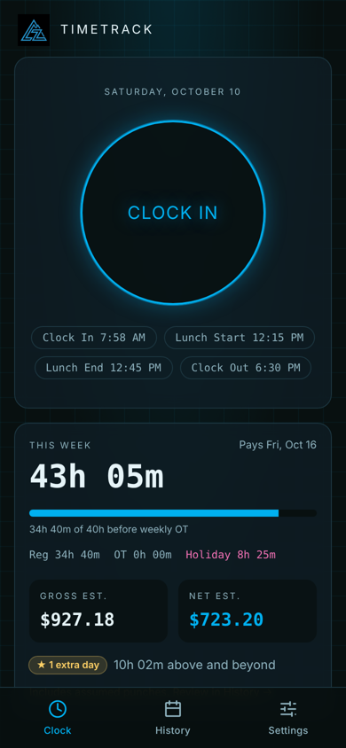
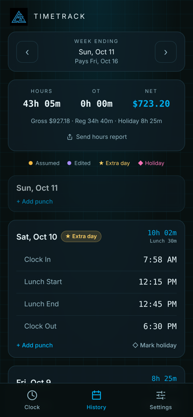
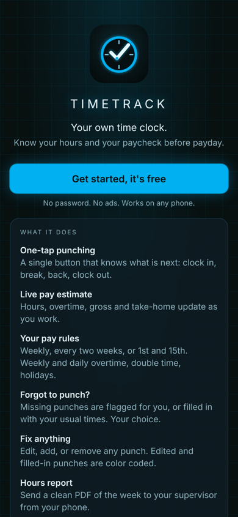
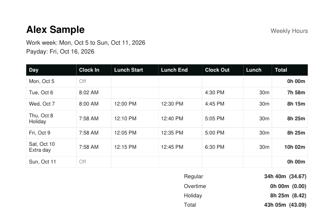

<p align="center">
  
</p>

<h1 align="center">Timetrack</h1>

<p align="center">
  <strong>Your own time clock. Know your hours and your paycheck before payday.</strong><br/>
  A free, installable web app for hourly workers.
</p>

<p align="center">
  <a href="https://timetrack.leadingzero.net"><strong>Open the app</strong></a> ·
  <a href="https://timetrack.leadingzero.net/about">About</a>
</p>

<p align="center">
  
  
  
</p>

---

## Why

Workplace time clocks rarely let you see your own history, and when you are asked to confirm your hours you are working from memory or photos of the clock. Timetrack keeps your own record, shows what your check should be, and produces a clean weekly report in one tap.

## Features

| | |
|---|---|
| **One-tap punching** | A single button that knows what is next: clock in, break, back, clock out |
| **Live pay estimate** | Hours, regular and overtime, gross and estimated take-home, updating while you work |
| **Flexible pay rules** | Weekly, biweekly, or semimonthly pay; weekly OT, optional daily OT and double time; holiday multiplier with a choice of whether holiday hours count toward OT |
| **Schedules** | Fixed days, every-other-week days, or no set schedule. Off-schedule shifts get an ★ Extra day badge |
| **Forgotten punches** | Flag them for you, or fill them with your usual times each night. Optional automatic lunch deduction |
| **Overnight shifts** | A 4 PM to 1 AM shift counts as one day (configurable cutoff) |
| **Full editing** | Edit, add, or remove any punch. Assumed (amber) and edited (violet) punches are color coded |
| **Hours report** | A one-page PDF of the week (punches, daily totals, regular and OT) shared straight from your phone |
| **No password** | Starts instantly. Add an email any time to keep your history across phones |

<p align="center"></p>

## Tech

- **Frontend:** React 19, Vite, Tailwind CSS 4, TanStack Query, installable PWA (`vite-plugin-pwa`)
- **Backend:** Supabase (Postgres with row-level security, anonymous auth plus email OTP, Edge Functions, pg_cron)
- **Hosting:** Vercel

```
src/
  pages/          Clock (Dashboard), History, Settings, Setup, About
  components/     UI primitives, settings sections, account, install prompt
  lib/
    pay.ts        Pay engine: weekly/daily OT, double time, holidays, pay periods
    report.ts     Weekly PDF report (jsPDF, loaded on demand)
    queries.ts    Supabase data hooks
    session.tsx   Anonymous sign-in, email linking, account merge
supabase/
  migrations/     Schema history for the `timetrack` schema
  functions/timetrack-sweep/   Nightly job that flags or fills missing punches
```

### Data model

All tables live in a dedicated `timetrack` Postgres schema, with row-level security restricting every row to its owner.

- `user_settings`: pay rules, schedule, and preferences (one row per user)
- `time_entries`: one row per punch, with `is_assumed`, edit history, and soft delete
- `day_overrides`: per-day flags such as holidays
- `v_daily_hours`: view computing net hours per work day

Pay is calculated in `src/lib/pay.ts` so the Clock screen can update live.

## Run it yourself

1. Create a Supabase project, apply `supabase/migrations/` in order, and deploy `supabase/functions/timetrack-sweep`.
2. In Supabase, add `timetrack` to **Exposed schemas** (Data API settings) and enable **Anonymous sign-ins**.
3. Set your project URL and publishable key in `.env`:
   ```
   VITE_SUPABASE_URL=https://<project>.supabase.co
   VITE_SUPABASE_PUBLISHABLE_KEY=sb_publishable_...
   ```
4. Run locally:
   ```
   npm install
   npm run dev
   ```

The publishable key is meant to be public. Access control is enforced in the database by row-level security.

## Disclaimer

Pay figures are estimates to help you plan. Your employer's payroll system is the official record.


---

<p align="center">
  <br/>
  <sub>Built by <strong>Leading Zero LLC</strong></sub>
</p>
